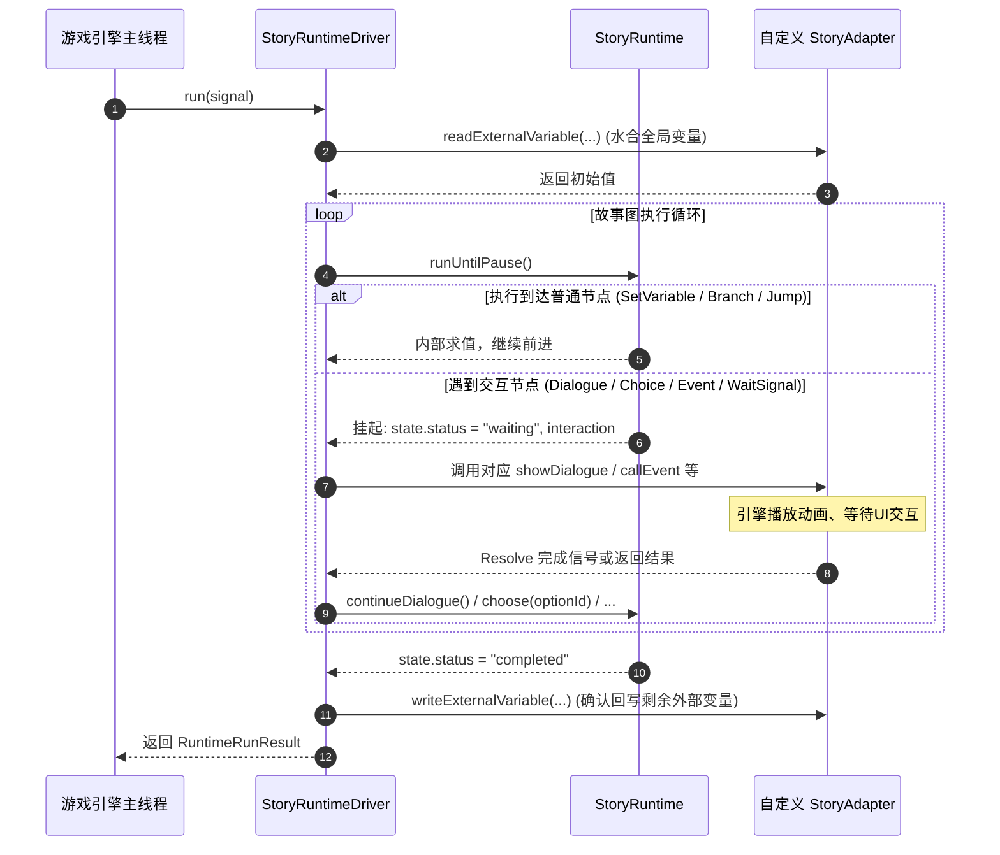

# StoryBlueprint 运行时适配器规范 (StoryAdapter Specification)

> **版本**：v1.0.0  
> **适用范围**：面向游戏引擎（Unity、Unreal Engine、Godot、自研引擎、Web 前端）实现 StoryBlueprint 故事虚拟机的接入与展示层开发。

---

## 目录

1. [架构定位与设计哲学](#1-架构定位与设计哲学)
2. [StoryAdapter 核心接口定义](#2-storyadapter-核心接口定义)
3. [交互数据模型 (Request / Result Schemas)](#3-交互数据模型-request--result-schemas)
4. [数据类型契约 (RuntimeValue & ValueType)](#4-数据类型契约-runtimevalue--valuetype)
5. [执行驱动循环与生命周期 (Runtime Driver Lifecycle)](#5-执行驱动循环与生命周期-runtime-driver-lifecycle)
6. [外部变量读写与防丢机制 (External Variable Protocol)](#6-外部变量读写与防丢机制-external-variable-protocol)
7. [信号与事件通信机制 (Signals vs Events)](#7-信号与事件通信机制-signals-vs-events)
8. [跨语言与引擎接入指南 (Unity / Unreal / Web)](#8-跨语言与引擎接入指南-unity--unreal--web)
9. [实现规范与避坑指南 (Best Practices & Pitfalls)](#9-实现规范与避坑指南-best-practices--pitfalls)

---

## 1. 架构定位与设计哲学

StoryBlueprint 采用严格的**逻辑与表现解耦架构**：

```
┌────────────────────────────────────────────────────────┐
│                   StoryBlueprint 宿主                   │
│                                                        │
│  ┌──────────────────────┐    驱动 / 取消 (Driver/Abort) │
│  │     StoryRuntime     │ ◄───────────────────────────┐│
│  │   (确定性图虚拟机)    │                             ││
│  │                      │ ──► 挂起交互 (Waiting) ───┐  ││
│  └──────────────────────┘                           │  ││
│                                                     ▼  ││
│  ┌────────────────────────────────────────────────────┐││
│  │                    StoryAdapter                    │││
│  │            (引擎渲染 / 表现 / 业务桥接层)            │││
│  └────────────────────────────────────────────────────┘││
└───────────────────────────┬────────────────────────────┘│
                            │ 驱动游戏世界 / 展现UI
                            ▼
      ┌───────────────────────────────────────────────┐
      │         游戏引擎 (Unity / Unreal / Web)         │
      │  UI 对话框 / 3D 角色动作 / 音效 / 任务系统 / 存档   │
      └───────────────────────────────────────────────┘
```

- **Runtime（虚拟机）的职责**：
  - 纯内存运行、确定性图拓扑遍历、分支条件判断、变量作用域隔离、表达式求值。
  - **不包含任何**渲染、UI 对话框、音频播放、摄像机镜头、动画或游戏引擎系统逻辑。
- **Adapter（适配器）的职责**：
  - 承接 Runtime 发出的每一步“故事挂起意图”（如展示台词、等待选项输入、调用外部游戏逻辑、等待外部信号通知）。
  - 连接具体引擎的 UI、语音、角色模型、背包系统和存档系统。
- **核心契约原则**：
  - **纯异步且可取消**：所有交互均返回 `Promise`（或对应语言的 Task/Future），并接收 `AbortSignal` 用于瞬时打断或跳过。
  - **单向只读与强校验**：Adapter **严禁**直接侵入修改 Runtime 内部私有内存；所有回传数据均必须通过定义好的 Result 结构由 Runtime 严格校验类型与 ID。

---

## 2. StoryAdapter 核心接口定义

TypeScript 标准接口签名如下：

```typescript
export interface StoryAdapter {
  /**
   * 1. 展现单句对话
   * 当剧情执行到 Dialogue 节点的一行台词时调用。
   * 等待玩家点击“继续”或打字机播完后 Resolve。
   */
  showDialogue(request: DialogueRequest, signal: AbortSignal): Promise<void>;

  /**
   * 2. 展现旁白/场景描述 (可选)
   * 若未实现，RuntimeDriver 会自动将旁白降级为无说话人的普通对话 (speakerless dialogue)。
   */
  showNarration?(request: NarrationRequest, signal: AbortSignal): Promise<void>;

  /**
   * 3. 展现分支选项
   * 展现 Choice 节点的多个分支选项，等待玩家做出选择。
   * 返回玩家选中的选项 OptionId。
   */
  showChoice(request: ChoiceRequest, signal: AbortSignal): Promise<OptionId>;

  /**
   * 4. 调用外部事件/函数 (单向派发或等待返回值)
   * 触发游戏逻辑（如加金币、播放全屏特效、开启战斗等）。
   * 若事件声明了返回值（outputs），Adapter 需将结果作为字典返回。
   */
  callEvent(request: EventRequest, signal: AbortSignal): Promise<EventResult>;

  /**
   * 5. Ink EXTERNAL 函数同步桥接 (可选)
   * 仅在执行嵌入式 Ink 块且 Ink 脚本内部调用了外部同步 EXTERNAL 函数时调用。
   */
  callExternalFunctionSync?(request: ExternalFunctionRequest): RuntimeValue;

  /**
   * 6. 等待外部信号 (同步/协调挂起点)
   * 暂停剧情，直到游戏系统满足特定条件（如击败 Boss、到达某坐标、玩家完成解谜）。
   * 游戏触发信号时 Resolve 携带的载荷 Payload。
   */
  waitForSignal(request: SignalRequest, signal: AbortSignal): Promise<SignalPayload>;

  /**
   * 7. 故事实例生命周期控制 (可选)
   * 控制独立故事实例的启动、切换、恢复或销毁 (Start / Switch / Resume / End Story)。
   */
  controlStory?(request: StoryControlRequest, signal: AbortSignal): Promise<StoryControlResult>;

  /**
   * 8. 多语言文本解析
   * 根据 textId 和语言区域代号（如 "zh-CN"、"en-US"）查找本地化翻译。
   * 若返回 undefined，Runtime 默认回退使用节点内写死的 defaultText。
   */
  resolveText(textId: TextId, locale: string): Promise<string | undefined>;

  /**
   * 9. 读取外部全局变量
   * 剧情启动前，从游戏全局状态（如玩家属性、世界标记位）中读取变量初值。
   */
  readExternalVariable(variable: VariableDefinition): Promise<RuntimeValue>;

  /**
   * 10. 回写外部全局变量
   * 当剧情内 SetVariable 修改了外部变量时调用，Adapter 应同步持久化或更新到游戏引擎状态。
   */
  writeExternalVariable(variable: VariableDefinition, value: RuntimeValue): Promise<void>;
}
```

---

## 3. 交互数据模型 (Request / Result Schemas)

### 3.1 对话请求 (`DialogueRequest`)
```typescript
export interface DialogueRequest {
  /** 保证本次展示请求唯一性的请求 ID */
  requestId: string;
  /** 说话人角色稳定 ID (在 Characters 表中注册，无说话人时为 undefined) */
  speakerId?: CharacterId;
  /** 本地化词条稳定 ID */
  textId: TextId;
  /** 默认文本 (已求值完变量模板插值后的文本，如 "你好，旅行者！") */
  defaultText: string;
  /** 语音资产引用 (包含资产 ID 及语言变体) */
  voice?: { assetId: string; locale?: string };
  /** 说话时的情绪标签 (如 "happy", "angry", "surprised") */
  emotion?: string;
  /** 说话人的肖像资产 ID */
  portraitId?: AssetId;
  /** 自定义扩展标签列表 (可用于触发 UI 震屏、音效等) */
  tags?: readonly string[];
}
```

### 3.2 旁白请求 (`NarrationRequest`)
```typescript
export interface NarrationRequest {
  requestId: string;
  textId: TextId;
  defaultText: string;
  voice?: { assetId: string; locale?: string };
}
```

### 3.3 选项请求 (`ChoiceRequest`)
```typescript
export interface ChoiceRequest {
  requestId: string;
  /** 提示语文本 ID (可选) */
  promptTextId?: TextId;
  /** 提示语文本 (如 "你想怎么做？") */
  defaultPrompt?: string;
  /** 可供选择的选项列表 */
  options: readonly {
    /** 选项稳定 ID */
    id: OptionId;
    /** 选项本地化文本 ID */
    textId: TextId;
    /** 选项显示文本 (已求值完模板插值) */
    defaultText: string;
    /** 该选项是否可用 (由前置条件 condition 判定得出；false 表示置灰但可见) */
    enabled: boolean;
  }[];
}
```

### 3.4 事件请求 (`EventRequest`) 与结果 (`EventResult`)
```typescript
export interface EventRequest {
  requestId: string;
  /** 项目级事件稳定 ID */
  eventId: EventId;
  /** 传入参数键值字典 (值已通过表达式求值完毕) */
  arguments: Readonly<Record<string, RuntimeValue>>;
  /** 预期输出参数列表 (若为空表示纯单向通知) */
  outputs: readonly {
    id: string;
    name: string;
    valueType: ValueType;
  }[];
}

/** 事件返回值字典：以 outputs 数组里的 id 为 Key，求值结果为 Value */
export type EventResult = Readonly<Record<string, RuntimeValue>>;
```

### 3.5 信号等待请求 (`SignalRequest`) 与载荷 (`SignalPayload`)
```typescript
export interface SignalRequest {
  requestId: string;
  /** 项目级信号稳定 ID */
  signalId: SignalId;
  /**
   * 匹配约束字典。
   * 若字段指定了值，表示必须强匹配该值；未指定的字段匹配任意值。
   */
  matches: SignalPayload;
}

/** 信号携带的数据载荷字典 */
export type SignalPayload = Readonly<Record<string, RuntimeValue>>;
```

### 3.6 故事控制请求 (`StoryControlRequest`) 与结果 (`StoryControlResult`)
```typescript
export type StoryControlAction = 'start' | 'switch' | 'resume' | 'end';

export interface StoryControlRequest {
  requestId: string;
  action: StoryControlAction;
  storyId?: string;
  instanceId?: string;
  arguments: Readonly<Record<string, RuntimeValue>>;
  waitForCompletion: boolean;
}

export interface StoryControlResult {
  instanceId?: string;
  outputs?: Readonly<Record<string, RuntimeValue>>;
}
```

---

## 4. 数据类型契约 (RuntimeValue & ValueType)

StoryBlueprint 拥有严格的类型体系，所有流经 Adapter 的值必须遵循此映射关系：

| 蓝图类型 (`ValueType.kind`) | TypeScript / JS 类型 | C# 类型 (Unity/Godot) | C++ 类型 (Unreal) | 规范说明 |
| :--- | :--- | :--- | :--- | :--- |
| **`boolean`** | `boolean` | `bool` | `bool` | 逻辑布尔值 |
| **`number`** | `number` | `double` 或 `float` | `double` | 浮点或整型数值 |
| **`string`** | `string` | `string` | `FString` | UTF-8 字符串 |
| **`json`** | `Record<string, any>` | `JObject` / 自定义 class | `TSharedPtr<FJsonObject>` | 对应 Engine Type Schema |
| **`array`** | `RuntimeValue[]` | `List<object>` | `TArray<FRuntimeValue>` | 同构/异构列表 |
| **`map`** | `Record<string, RuntimeValue>` | `Dictionary<string, object>` | `TMap<FString, FRuntimeValue>` | 字典 |
| **`struct`** | `Record<string, RuntimeValue>` | `Dictionary<string, object>` | `TSharedPtr<FJsonObject>` | 具名字段结构体 |
| **`character-ref`** | `string` (UUID/StableId) | `string` | `FString` | 角色引用稳定 ID |
| **`asset-ref`** | `string` (UUID/StableId) | `string` | `FString` | 资产引用稳定 ID |
| **`enum`** | `string` (枚举字面量) | `string` 或 `enum` | `FString` 或 `enum class` | 枚举选项字符串 |

> ⚠️ **类型防护机制**：  
> Runtime 会在收到 Adapter 返回的每个数据项时调用 `runtimeValueMatchesType(value, expectedType)`。如果 Adapter 返回了与约定类型不匹配的值，Runtime 会立即终止执行并抛出精确的诊断码 `INVALID_ADAPTER_RESULT`，绝不让脏数据在后续图逻辑中雪崩。

---

## 5. 执行驱动循环与生命周期 (Runtime Driver Lifecycle)

StoryBlueprint 提供了标准执行驱动器 `StoryRuntimeDriver`，其工作流程如下：



### 取消（Abort）支持
在玩家跳过剧情、退出游戏、切换场景或载入新存档时，引擎需调用传入的 `AbortController.abort()`：
1. Adapter 接收到 `signal.aborted === true` 或 `signal.onabort` 事件。
2. Adapter 应当立即关闭正在显示的 UI、停止当前等待的 Task/Promise。
3. `StoryRuntimeDriver` 捕获到中断后立即停止，并返回 `{ kind: 'failed', diagnostic: { code: 'ABORTED' } }`。

---

## 6. 外部变量读写与防丢机制 (External Variable Protocol)

外部变量（Scope: `project` 且标记为 external）代表游戏全局世界状态（如 `PlayerGold`、`CurrentQuestStage`）。

### 1. 读变量（Hydration）
故事实例启动时，Driver 会遍历所有引用的外部变量，依次调用：
```typescript
const value = await adapter.readExternalVariable(variableDefinition);
runtime.hydrateExternalVariable(variableDefinition.id, value);
```

### 2. 写变量与防丢队列（Write Coalescing & Acknowledgment）
在故事执行过程中，剧情节点可能多次修改同一个外部变量：
1. Runtime 内部维护了一个 **写回缓冲队列（External Variable Write Queue）**。
2. 在每一次与 Adapter 发生异步交互前以及故事执行完毕时，Driver 都会执行 `flushExternalWrites()`：
   ```typescript
   for (const write of this.runtime.peekExternalVariableWrites()) {
     await this.adapter.writeExternalVariable(write.variable, write.value);
     this.runtime.acknowledgeExternalVariableWrite(write.variable.id);
   }
   ```
3. **关键安全性**：只有当 Adapter 的 `writeExternalVariable` Promise 成功 Resolve 之后，该写操作才会被正式从队列中移除（`acknowledge`）。**如果 Adapter 写回失败报错，写回请求仍停留在队列中**，宿主可以在故障排查后重试，确保不会发生静默数据丢失。

---

## 7. 信号与外部函数/事件通信机制 (Signals vs External Functions / Events)

> **术语说明**：在编辑器界面和作者视角中，`CallEvent` 节点显示为 **Call External Function**（外部函数调用），二者在代码底层为同一实现（`CallEvent` / `EventRequest`）。

许多初学者容易混淆 `Call External Function`（`CallEvent`）和 `Wait for Signal`（`WaitSignal`），两者在设计理念上有本质区别：

| 特性维度 | Call External Function (CallEvent) 节点 | Wait for Signal 节点 |
| :--- | :--- | :--- |
| **通信方向** | **剧情 ➔ 引擎**（命令模式 Command） | **引擎 ➔ 剧情**（观察者/信号模式 Observer） |
| **触发主体** | 剧情流经该节点时发起 | 游戏外部系统随时产生 |
| **执行语义** | “剧情命令游戏做某事”（如扣金币） | “剧情在此停下，等待外部条件满足”（如等待开门） |
| **返回值/载荷** | 由 Adapter 异步返回预定义的 `EventResult` | 由外部触发时送入 `SignalPayload` |
| **提前到达处理** | 无提前概念，流经即执行 | **支持提前到达信箱（Signal Inbox）** |

### 信号提前到达机制 (Signal Inbox Buffer)
在真实游戏中，外部信号经常早于剧情节点到达（例如玩家提前把怪物击杀了，然后才走到对话触发剧情）。
StoryBlueprint 原生支持**提前到达缓冲**：
- 游戏引擎可以随时直接调用：
  ```typescript
  runtime.sendSignal("sig_boss_killed", { bossId: "dragon_01" });
  ```
- 若剧情**尚未执行到**该 `WaitSignal` 节点：Runtime 会自动将该载荷暂存在持久化状态的 `state.signalInbox` 队列中。
- 当剧情后续流经 `WaitSignal` 节点时：Runtime 会第一时间检索 Inbox，如果发现匹配项，**完全不需要挂起 Adapter**，直接消费该信号并瞬时继续下游执行！

---

## 8. 跨语言与引擎接入指南 (Unity / Unreal / Web)

### 8.1 Unity (C#) 接入参考示例

在 Unity 中，建议通过 C# Interface 实现并配合 `UniTask` 或 `Task`：

```csharp
using System.Threading;
using System.Threading.Tasks;
using System.Collections.Generic;

public class UnityStoryAdapter : IStoryAdapter
{
    private DialogueUI dialogueUI;
    private ChoiceUI choiceUI;

    public async Task ShowDialogueAsync(DialogueRequest request, CancellationToken ct)
    {
        // 1. 设置角色肖像与名字
        dialogueUI.SetSpeaker(request.speakerId, request.emotion);
        // 2. 播放语音
        if (request.voice != null) AudioManager.PlayVoice(request.voice.assetId);
        // 3. 展现打字机台词并等待玩家点击屏幕
        await dialogueUI.PlayTextAndWaitClickAsync(request.defaultText, ct);
    }

    public async Task<string> ShowChoiceAsync(ChoiceRequest request, CancellationToken ct)
    {
        // 渲染选项列表，等待玩家点击某个按钮后返回选项 ID
        return await choiceUI.ShowOptionsAndWaitSelectionAsync(request.options, ct);
    }

    public async Task<Dictionary<string, object>> CallEventAsync(EventRequest request, CancellationToken ct)
    {
        if (request.eventId == "ev_add_item")
        {
            string itemId = (string)request.arguments["itemId"];
            int count = System.Convert.ToInt32(request.arguments["count"]);
            InventorySystem.AddItem(itemId, count);
            return new Dictionary<string, object> { { "success", true } };
        }
        return new Dictionary<string, object>();
    }

    public async Task<Dictionary<string, object>> WaitForSignalAsync(SignalRequest request, CancellationToken ct)
    {
        // 订阅游戏内部事件中心，直到收到目标信号
        var tcs = new TaskCompletionSource<Dictionary<string, object>>();
        using (ct.Register(() => tcs.TrySetCanceled()))
        {
            void OnSignal(Dictionary<string, object> payload)
            {
                if (Matches(payload, request.matches))
                {
                    SignalCenter.Unregister(request.signalId, OnSignal);
                    tcs.TrySetResult(payload);
                }
            }
            SignalCenter.Register(request.signalId, OnSignal);
            return await tcs.Task;
        }
    }

    public async Task<string> ResolveTextAsync(string textId, string locale) =>
        LocalizationManager.GetText(textId, locale);

    public async Task<object> ReadExternalVariableAsync(VariableDefinition variable) =>
        GameSaveData.Get(variable.id, variable.defaultValue);

    public async Task WriteExternalVariableAsync(VariableDefinition variable, object value) =>
        GameSaveData.Set(variable.id, value);
}
```

### 8.2 Unreal Engine 5 (C++) 接入设计建议

1. **头文件与 UInterface 声明**：
   - 继承 `UInterface` 定义 `UStoryAdapter` 与 `IStoryAdapter`。
   - 使用 `FTSTicker` 或 C++20 Coroutine / UE5 Latent Action 处理异步流程。
2. **文本与本地化**：
   - 将 `resolveText` 直接对接 Unreal 的 `FText` 与 String Table（`LOCTEXT` 系统）。
3. **事件派发**：
   - 将 `callEvent` 与游戏内的 Gameplay Ability System (GAS) 或 GameplayMessageSubsystem 结合。

---

## 9. 实现规范与避坑指南 (Best Practices & Pitfalls)

1. **必须严格监听取消信号（AbortSignal / CancellationToken）**：
   - 当玩家狂点“跳过”（Skip）或强制读档时，若 Adapter 忽略了信号，会导致旧对话的 Promise 依然悬挂在后台，造成界面状态错乱或内存泄露。
2. **严禁在 Adapter 内部偷偷修改剧情变量**：
   - 绝不要尝试绕过接口直接给 StoryRuntime 写入变量。所有变量变更必须走 `writeExternalVariable` 或 Event 返回值，否则会导致状态快照（State Snapshot）与撤销重做（Undo）系统失效。
3. **Event 返回值 Key 必须与 Event Output 的 `id` 一一对应**：
   - 蓝图编译器生成的是基于端口 ID（如 `evo_score`）的绑定，Adapter 返回字典的 Key 必须精准使用声明的 ID。
4. **纯粹性与防重**：
   - Adapter 本身应当是尽量无状态的，所有故事状态（包括局部变量、堆栈位置、提前收到的信号队列）均已完整序列化保存在 `RuntimeState` 中。如果游戏需要存档，只需将 `runtime.exportStateJson()` 存入存档槽位即可。

---

## 10. 完整样例 JSON (Sample JSON Artifacts)

为方便在外部新项目中直接调试、编写反序列化 Model 类以及进行单元测试，仓库中已生成了完整的示例文件：

- 🎮 **引擎运行时加载产物**：[`docs/examples/sample-quest.storyc.json`](file:///d:/Projects/StoryBlueprint/docs/examples/sample-quest.storyc.json)
- 🎨 **编辑器蓝图源文件**：[`docs/examples/sample-quest.story.json`](file:///d:/Projects/StoryBlueprint/docs/examples/sample-quest.story.json)

### 10.1 编译产物 JSON 结构详解 (`sample-quest.storyc.json`)

这是游戏引擎 Runtime **直接读取、执行**的指令集 JSON 文件。该示例包含完整的对话、插值变量、选项分支、变量赋值、等待外部信号、调用游戏事件和退出：

```json
{
  "format": "story-runtime",
  "version": 7,
  "id": "p_dragon_quest",
  "contentVersion": "dev",
  "entryBlockId": "b_start",
  "blocks": {
    "b_start": {
      "id": "b_start",
      "instructions": [
        {
          "id": "i_start_next",
          "op": "jump",
          "target": "b_dialogue_greet"
        }
      ]
    },
    "b_dialogue_greet": {
      "id": "b_dialogue_greet",
      "instructions": [
        {
          "id": "i_greet_main",
          "op": "dialogue",
          "text": {
            "id": "t_greet_player",
            "parts": [
              { "kind": "text", "value": "Welcome to our village, " },
              {
                "kind": "expression",
                "expression": {
                  "kind": "variable",
                  "variableId": "v_player_name",
                  "valueType": { "kind": "string" }
                }
              },
              { "kind": "text", "value": "! We desperately need your help." }
            ]
          },
          "tags": [
            "camera:close-up",
            "audio:village_bgm"
          ]
        },
        {
          "id": "i_dialogue_greet_next",
          "op": "jump",
          "target": "b_choice_quest"
        }
      ]
    },
    "b_choice_quest": {
      "id": "b_choice_quest",
      "instructions": [
        {
          "id": "i_choice_quest_main",
          "op": "choice",
          "prompt": {
            "id": "t_choice_prompt_choice_quest",
            "parts": [
              { "kind": "text", "value": "Will you take up the quest to defeat the dragon?" }
            ]
          },
          "options": [
            {
              "id": "opt_accept",
              "text": {
                "id": "t_choice_option_accept",
                "parts": [
                  { "kind": "text", "value": "I will defeat the dragon for you!" }
                ]
              },
              "target": "b_set_accepted"
            },
            {
              "id": "opt_decline",
              "text": {
                "id": "t_choice_option_decline",
                "parts": [
                  { "kind": "text", "value": "Sorry, I am not ready yet." }
                ]
              },
              "target": "b_end_decline"
            }
          ]
        }
      ]
    },
    "b_set_accepted": {
      "id": "b_set_accepted",
      "instructions": [
        {
          "id": "i_set_accepted_main",
          "op": "set-variable",
          "variableId": "v_quest_accepted",
          "value": {
            "kind": "literal",
            "value": true,
            "valueType": { "kind": "boolean" }
          }
        },
        {
          "id": "i_set_accepted_next",
          "op": "jump",
          "target": "b_wait_dragon"
        }
      ]
    },
    "b_wait_dragon": {
      "id": "b_wait_dragon",
      "instructions": [
        {
          "id": "i_wait_dragon_main",
          "op": "wait-signal",
          "signalId": "sig_boss_slain",
          "matches": {
            "bossId": {
              "kind": "literal",
              "value": "red_dragon",
              "valueType": { "kind": "string" }
            }
          }
        },
        {
          "id": "i_wait_dragon_next",
          "op": "jump",
          "target": "b_call_reward"
        }
      ]
    },
    "b_call_reward": {
      "id": "b_call_reward",
      "instructions": [
        {
          "id": "i_call_reward_main",
          "op": "call-event",
          "eventId": "ev_grant_reward",
          "arguments": {
            "amount": { "kind": "literal", "value": 500, "valueType": { "kind": "number" } },
            "reason": { "kind": "literal", "value": "Dragon Slaying", "valueType": { "kind": "string" } }
          },
          "outputs": [
            { "id": "evo_success", "name": "success", "valueType": { "kind": "boolean" } }
          ],
          "resultVariableIds": {}
        },
        {
          "id": "i_call_reward_next",
          "op": "jump",
          "target": "b_end_victory"
        }
      ]
    },
    "b_end_victory": {
      "id": "b_end_victory",
      "instructions": [
        {
          "id": "i_end_victory_main",
          "op": "end-story"
        }
      ]
    },
    "b_end_decline": {
      "id": "b_end_decline",
      "instructions": [
        {
          "id": "i_end_decline_main",
          "op": "end-story"
        }
      ]
    }
  },
  "chapters": {},
  "variables": [
    {
      "id": "v_player_gold",
      "name": "gold",
      "displayName": "Player Gold",
      "scope": "story",
      "valueType": { "kind": "number" },
      "defaultValue": 100
    },
    {
      "id": "v_player_name",
      "name": "playerName",
      "displayName": "Player Name",
      "scope": "story",
      "valueType": { "kind": "string" },
      "defaultValue": "Hero"
    },
    {
      "id": "v_quest_accepted",
      "name": "questAccepted",
      "displayName": "Quest Accepted",
      "scope": "story",
      "valueType": { "kind": "boolean" },
      "defaultValue": false
    }
  ]
}
```

### 10.2 引擎接入时的反序列化建议

1. **基本块（Basic Block）模型**：
   - 整个故事被划分为多个 `blocks`，每个块包含线性顺序的 `instructions`。
   - 块末尾是指向下一个块的跳转终止指令（`jump`、`branch`、`choice`、`end-story`）。
   - 运行时只需要记录当前执行的 `blockId` 和 `instructionIndex`，天然便于序列化存档与读档恢复。
2. **表达式（TypedExpression）**：
   - 字面量：`{ "kind": "literal", "value": 500, "valueType": { "kind": "number" } }`
   - 变量求值：`{ "kind": "variable", "variableId": "v_player_name", "valueType": { "kind": "string" } }`
   - 算术与比较：`{ "kind": "binary", "operator": ">=", "left": ..., "right": ... }`
3. **文本模板（RuntimeTextTemplate）**：
   - `text.parts` 包含文本切片和变量插值切片，在展示前由虚拟机自动拼接并填充进 `DialogueRequest.defaultText` 中，引擎端如果不需要自定义富文本解析，直接使用求值好的 `request.defaultText` 即可！

